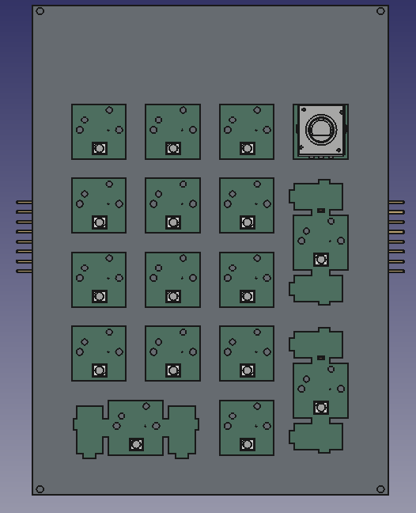
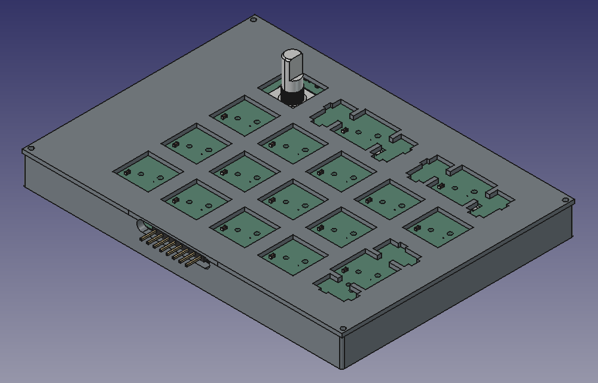
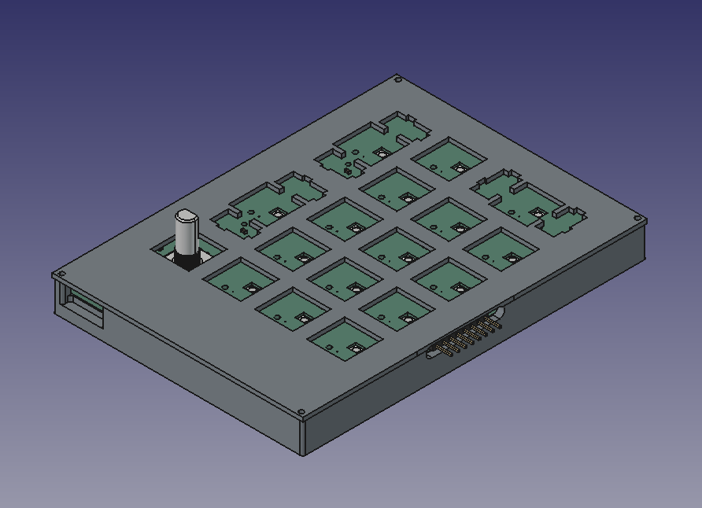
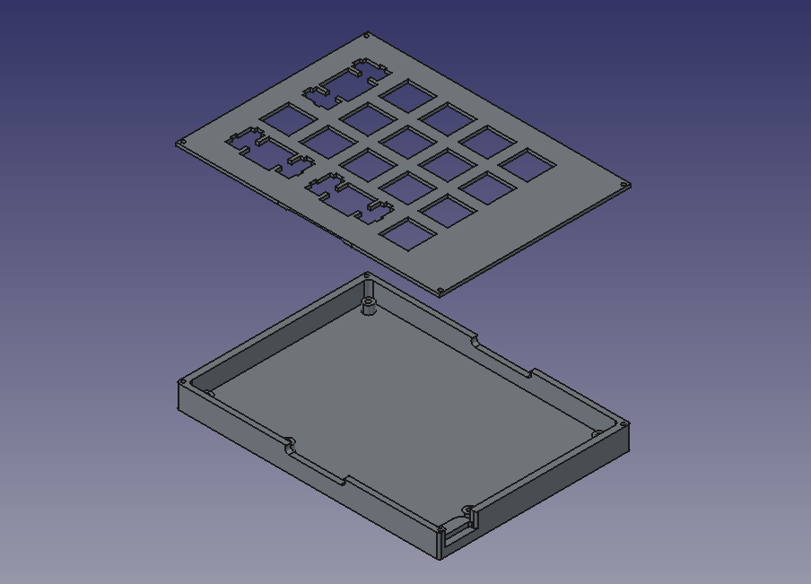

# Phantom Macro Mk.1 Series

> A modular, snap-together macropad ecosystem with lateral pogo-pin bus interconnects.

Chain modules side-by-side to expand your desktop workflow—from a compact macro-pad into a full fledge keyboard.

---

## 📌 Project Status

- **Hardware:** Series still in-dev
- **Firmware:** Pad is almost complete but I need to built it to measure the adc. Others are still in-dev
- **Interconnect:** Custom edge-mount 8 pin pogo interface.

---

## ⚡ Features

- **Snap & Chain Topology:** Expand your layout horizontally by mating adjacent modules using edge-mounted pogo connectors.
- **Unified Bus Standard:** Standardized power, ground, and communication rails allow any Mk.1-series compatible module to hot-mate with the system.
- **Flexible Layouts:** Mix and match different form factors (numpads, macro clusters, encoder dials) without rerunning separate USB cables to your host machine.

## ⚠️ Build Warnings

> [!WARNING]
> **DIY Soldering Required:** This is a fully self-assembled project. It is not a plug-and-play kit and requires intermediate soldering experience.

* **Double-Sided Assembly:** Depending on the macro-pad, components might need to be soldered onto **both the top and bottom** of the PCB.

## *Mk.1 Series*

  
<b>🔢 Phantom-Macro-Mk.1 Pad (click here)</b>

  
  ### Macro Mk.1 Pad
  
  #### Schematic

#### PCB Layout

4 Layers PCB

  

| Front (1st layer) | Bottom (4th layer) |
| ----------------- | ------------------ |
|  |  |
|  |  |

#### PCB
| Front | Back |
| ----- | ---- |
|  |  |
|  |  |

#### Case

<table>
  <tbody>
    <tr>
      <td width="50%">
        
      </td>
      <td width="50%">
        
      </td>
    </tr>
    <tr>
      <td width="50%">
        
      </td>
      <td width="50%">
        
      </td>
    </tr>
  </tbody>
</table>

  
<b>🎹 Phantom-Macro-Mk.1 MIDI (click here)</b>

  
  ### Macro Mk.1 MIDI
  
  #### Schematic

  

  ### PCB Layout 

  2 Layers PCB
  
  

  
  | Front | Back |
  | ----- | ----- |
  |  |  |
  |  |  |
  
  
  #### PCB
  | Front | Back |
  | ----- | ---- |
  |  |  |
  |  |  |

